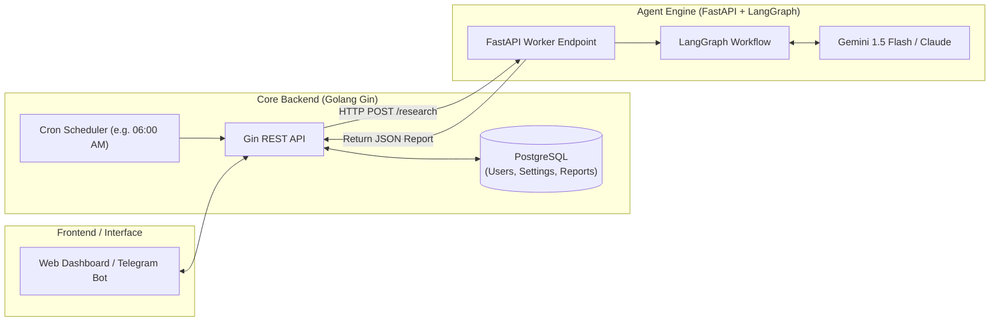
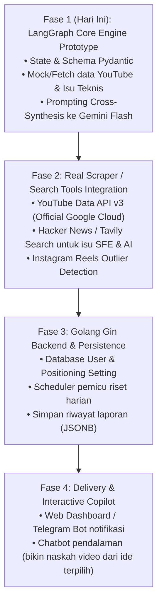

# 🚀 TrendLens: AI Content Intelligence Agent (Roadmap & Action Plan)

Dokumen ini berisi arsitektur, roadmap bertahap, dan **langkah konkret yang bisa kamu eksekusi hari ini** untuk membangun agen riset konten AI & Software Engineering.

---

## 🎯 Visi Produk
Sistem cerdas otomatis yang setiap hari:
1. Mengamati **gaya & hook video viral** di YouTube & Instagram.
2. Meriset **isu teknis & update terkini** di niche kamu (AI / Software Engineering).
3. Mengawinkan keduanya menjadi **Katalog Ide Konten Harian (10–15+ Ide)** yang sudah disesuaikan dengan *positioning / persona* kamu, lengkap dengan **sumber referensi yang bisa diverifikasi**.

---

## 🏗️ Arsitektur Sistem



---

## 📅 Roadmap Pengembangan



---

## ⚡ Apa yang Harus Dikerjakan Hari Ini? (Action Plan Hari Ini)

> **Prinsip Hari Ini:** Jangan sentuh Golang, Database, atau Web UI dulu! Hari ini fokus **membuktikan "otak" AI-nya berjalan (Proof of Concept)**.

Target hari ini adalah membuat 1 file runnable script di `fastapi/` yang bisa menghasilkan **katalog ide JSON terstruktur** dari input niche + positioning.

### Checklist Tugas Hari Ini:

- [ ] **Langkah 1: Tentukan Schema Output (`schema.py`)**
  Bikin class Pydantic untuk struktur kartu ide:
  ```python
  from pydantic import BaseModel, Field

  class ContentIdea(BaseModel):
      category: str = Field(description="Misal: Hot Takes, Utility Hack, Career Reality")
      topic_title: str = Field(description="Judul konsep ide konten")
      viral_hooks: list[str] = Field(description="2-3 pilihan kalimat hook pembuka 3 detik pertama")
      content_outline: list[str] = Field(description="3-4 poin pokok isi pembahasan video")
      why_it_works: str = Field(description="Alasan psikologi/analisis kenapa ide ini bakal ramai")
      source_technical_topic: str = Field(description="Topik/isu teknis yang mendasari ide ini")
      source_reference_url: str = Field(description="Link referensi video atau artikel asli")

  class DailyResearchReport(BaseModel):
      date: str
      target_niche: str
      user_positioning: str
      ideas: list[ContentIdea]
  ```

- [ ] **Langkah 2: Buat State LangGraph (`state.py`)**
  Siapkan data penampung alur agen:
  * `niche` (misal: "AI & Software Engineering")
  * `user_positioning` (misal: "Senior Dev praktis, gaya kasual sarkas, benci hype palsu")
  * `viral_trends_raw`: Data mentah tren medsos (YouTube/IG)
  * `tech_news_raw`: Data mentah isu teknis (Hacker News / Reddit / Release update)
  * `final_report`: Output bertipe `DailyResearchReport`

- [ ] **Langkah 3: Buat Prompt Cross-Synthesis (`chains.py`)**
  Prompt yang menginstruksikan LLM (Gemini 1.5 Flash):
  > *"Kamu adalah Content Director & Tech Researcher. Ambil pola hook dari data viral medsos dan kawinkan dengan isu teknis terkini. Sesuaikan tone dan sudut pandang (angle) dengan positioning user. Hasilkan 8-12 ide konten unik."*

- [ ] **Langkah 4: Jalankan & Evaluasi Output Pertama**
  Jalankan graph dengan input kamu sendiri. Lihat apakah ide yang keluar terasa "daging" dan relevan dengan gayamu.

---

## 🛠️ Rekomendasi Tech Stack & Tools

| Kebutuhan | Tool Terpilih | Alasan |
| :--- | :--- | :--- |
| **Agent Orchestrator** | **LangGraph** (Python) | Cocok untuk alur multi-step, stateful, dan branching logic. |
| **LLM Model** | **Gemini 1.5 Flash** (Google AI Studio) | Gratis tier dev, context window 1M token (kuat nampung banyak transkrip), respons instan. |
| **Technical News Fetcher** | **Hacker News API** (Gratis) / **Tavily Search API** | Sumber berita dan debat teknis komunitas SFE nomor 1. |
| **Video Trend Fetcher** | **YouTube Data API v3** | Kuota gratis 10.000 units/hari dari Google Cloud Console. |
| **Core Backend** | **Golang (Gin)** | Cepat, efisien memori, cocok untuk cron scheduler & multi-tenant auth. |
| **Database** | **PostgreSQL (JSONB)** | Fleksibel menyimpan hasil report JSON tanpa perlu ubah-ubah skema tabel. |

---

## 📌 Status Progress
* [x] Perencanaan Arsitektur & Strategi Model
* [x] Penyusunan File Roadmap
* [ ] Pembuatan Schema & State LangGraph
* [ ] Uji Coba Sintesis Ide Pertama
