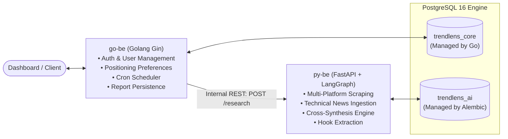

# 🔍 TrendLens

> **Autonomous AI Content Intelligence & Research Engine**
> 
> TrendLens monitors trending short-form content across YouTube & Instagram, researches real-world technical developments in your specific domain (AI / Software Engineering), and synthesizes them into actionable, high-performing content ideas tailored to your custom creator positioning.

---

## 🏗️ Architecture Overview

TrendLens uses a modern **Microservices Monorepo** architecture separating core business logic (Golang) from AI reasoning workflows (Python LangGraph):



### Why Dual Databases?
* **`trendlens_core` (Go):** Handles relational integrity for `users`, authentication, subscription tiers, and tenant settings.
* **`trendlens_ai` (Python):** Handles LangGraph agent thread checkpoints (`langgraph-checkpoint-postgres`), raw scraping cache, and evaluation logs via Alembic migrations.
* **Shared Engine, Isolated Storage:** Both databases run inside a single PostgreSQL container initialized via an automated startup script.

---

## 📁 Repository Layout

```
trendlens/
├── .agents/                         # AI Agent operational standards & git commit rules
│   ├── git-standards.md             # Conventional commits & atomic boundaries
│   └── rules.md                     # General workspace guidelines
│
├── go-be/                           # Core Backend API (Golang & Gin)
│   ├── Dockerfile
│   └── .gitkeep
│
├── py-be/                           # AI Research Agent Service (FastAPI & LangGraph)
│   ├── app/
│   │   ├── agents/                  # LangGraph graphs, nodes, states, tools
│   │   ├── api/                     # FastAPI presentation layer & routers
│   │   ├── core/                    # Settings & database connection
│   │   ├── models/                  # SQLAlchemy ORM models
│   │   ├── schemas/                 # Pydantic validation DTOs
│   │   └── services/                # Business logic orchestrators
│   ├── Dockerfile
│   ├── ARCHITECTURE_RULES.md        # Strict architecture & Alembic guidelines
│   └── pyproject.toml
│
├── docker/                          # Container initialization assets
│   └── postgres/
│       └── init-databases.sql       # Startup script for dual-database creation
│
├── compose.yml                      # Local development Docker Compose
├── .env.example                     # Environment variables blueprint
└── README.md                        # Project documentation
```

---

## 🚀 Getting Started

### Prerequisites
* [Docker Desktop](https://www.docker.com/products/docker-desktop/) installed and running.
* [Go 1.23+](https://go.dev/) (for `go-be` local development).
* [Python 3.12+](https://www.python.org/) and [`uv`](https://github.com/astral-sh/uv) (for `py-be` local development).

### 1. Environment Configuration
Copy the example environment file:
```bash
cp .env.example .env
```
Add your **Google Gemini API Key** (`GEMINI_API_KEY`) from [Google AI Studio](https://aistudio.google.com/).

### 2. Start PostgreSQL with Dual Databases
To launch the database container with both `trendlens_core` and `trendlens_ai` initialized:
```bash
docker compose up -d postgres
```

Verify that both databases exist:
```bash
docker exec -it trendlens_postgres psql -U postgres -c "\l"
```

---

## 📜 Development Guidelines & Commit Rules

All contributions and AI agent operations must follow:
* **[Git Commit Standards](.agents/git-standards.md):** Conventional Commits (`feat(scope): description`) with atomic boundaries.
* **[Python Architecture Rules](py-be/ARCHITECTURE_RULES.md):** Strict Alembic migration protocols and layer separation.

---

## 📄 License
MIT License.
